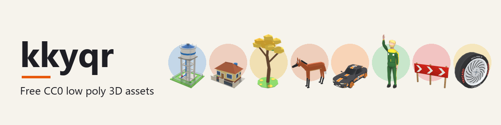
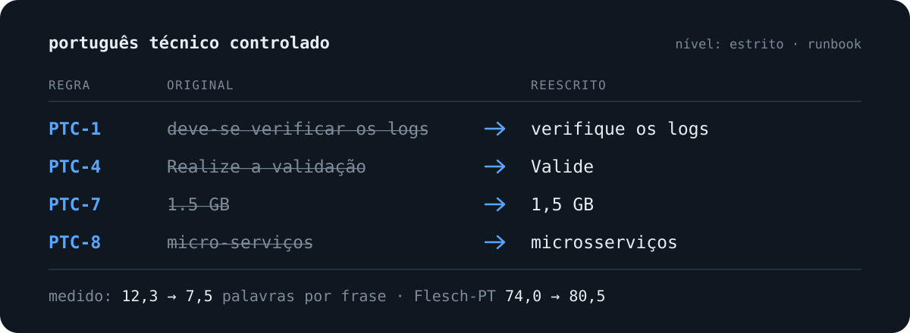
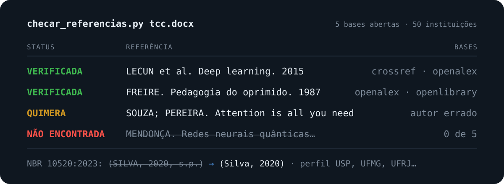
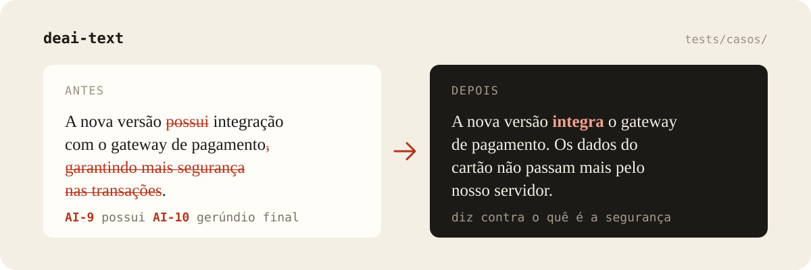

# Kayque 👋

Escrevo código desde 2002, quando tinha 11 anos, e trabalho com isso desde 2013. Sou **Gerente de Tecnologia da Informação** na ImobiBrasil desde 2018. Lá cuido do CRM imobiliário de ponta a ponta: backend em PHP e MySQL, app em Flutter e a infraestrutura.

Fora do trabalho, escrevo skills para o Claude Code que revisam texto em português e conferem citações ABNT, faço um jogo educativo sobre água no mestrado e publico packs de modelos 3D low poly gratuitos no [itch.io](https://kkyqr.itch.io).

## Projetos

### 🧊 [Assets 3D low poly no itch.io](https://kkyqr.itch.io)

<a href="https://kkyqr.itch.io"></a>

Oito packs de modelos 3D em glTF/GLB, todos em domínio público (CC0): uso livre, inclusive comercial, sem precisar de crédito. O download no itch é gratuito e a doação é opcional. O código e os scripts do Blender ficam no GitHub.

| Pack | O que tem | itch.io | GitHub |
|---|---|---|---|
| City Kit | 129 modelos para city builder: prédios, ruas e terreno modulares, veículos | [baixar](https://kkyqr.itch.io/low-poly-city-kit) | [repo](https://github.com/kayquer/kit-cidade-lowpoly) |
| Brazil Buildings | 45 prédios com cara de cidade brasileira | [baixar](https://kkyqr.itch.io/low-poly-brazil-buildings-kit) | [repo](https://github.com/kayquer/kit-predios-brasil-lowpoly) |
| Brazil Props | 100 props de natureza, rua, rio e poluição | [baixar](https://kkyqr.itch.io/low-poly-brazil-props-kit) | [repo](https://github.com/kayquer/kit-props-brasil-lowpoly) |
| Threatened Fauna | 435 espécies do Livro Vermelho da fauna ameaçada | [baixar](https://kkyqr.itch.io/threatened-brazilian-fauna-low-poly-kit) | [repo](https://github.com/kayquer/kit-fauna-ameacada-lowpoly) |
| Rally Fleet 64 | 89 carros de rali com visual de console de 64 bits | [baixar](https://kkyqr.itch.io/scitizia-rally-fleet-64) | [repo](https://github.com/kayquer/scitizia-frota-64) |
| Rally People | 55 personagens com esqueleto e 10 animações | [baixar](https://kkyqr.itch.io/scitizia-people) | [repo](https://github.com/kayquer/scitizia-pessoas-64) |
| Rally Props 64 | 142 props de rali, 69 quebráveis | [baixar](https://kkyqr.itch.io/scitizia-props-64) | [repo](https://github.com/kayquer/scitizia-props-64) |
| Wheels 64 | 39 rodas, 36 pneus e 39 conjuntos montados | [baixar](https://kkyqr.itch.io/scitizia-wheels-64) | [repo](https://github.com/kayquer/scitizia-rodas-64) |

### 📐 [Português Técnico Controlado](https://github.com/kayquer/portugues-tecnico-controlado)

Reescreve texto técnico em PT-BR para ter uma leitura só. Inspirada no ASD-STE100, com 9 regras próprias, 3 níveis de rigor e um modo bilíngue EN/PT que confere se as duas versões dizem a mesma coisa.

<a href="https://github.com/kayquer/portugues-tecnico-controlado"></a>

Serve para tutorial, documentação, runbook e procedimento. → [Página de instalação](https://kayquer.github.io/portugues-tecnico-controlado/) (Claude Code, Claude.ai, Cursor, Codex, Gemini CLI, ChatGPT e Perplexity)

### 📚 [Citações ABNT](https://github.com/kayquer/citacoes-abnt-skill)

Confere se as referências de um TCC, artigo ou tese existem de fato e aplica a ABNT vigente com as regras do manual da universidade. Cada obra é procurada em cinco bases abertas (Crossref, OpenAlex, Semantic Scholar, Open Library e Google Books). Só passa como verificada a obra que aparece em pelo menos duas delas. Referência inventada por IA, título real com autor trocado e DOI de outra obra aparecem separados.

<a href="https://github.com/kayquer/citacoes-abnt-skill"></a>

Formata pela NBR 6023:2025, 10520:2023 e 14724:2024. Traz os perfis de 50 instituições, entre elas USP, Unicamp, UFMG, UFRJ, institutos federais e Fatec, cada um com o link do manual oficial consultado. Também gera o modelo Word da instituição e exporta a bibliografia em BibTeX, RIS e CSL-JSON.

```bash
claude plugin marketplace add kayquer/citacoes-abnt-skill
claude plugin install citacoes-abnt@citacoes-abnt-skill
```

→ [Regras de cada universidade](https://kayquer.github.io/citacoes-abnt-skill/) · [Normas ABNT vigentes em 2026](https://kayquer.github.io/citacoes-abnt-skill/normas-abnt-vigentes.html)

### 💧 [Guardião da Água](https://github.com/kayquer/guardiao_da_agua_js)

<a href="https://kayquer.github.io/guardiao_da_agua_js/"></a>

Jogo educativo de construção de cidade sobre recursos hídricos, para o 6º ano. O estudante governa a cidade e aprende de onde vem a água, por que ela falta ou fica poluída e como cada escolha afeta rios e nascentes. Pesquisa de mestrado na Unesp, feito em JavaScript com Babylon.js.

**[▶ Jogar no navegador](https://kayquer.github.io/guardiao_da_agua_js/)**, sem instalar nada.

### ✂️ [deai-text](https://github.com/kayquer/deai-text)

Remove padrões de texto de IA. Cada trecho marcado sai com o ID da regra, a skill reescreve e depois faz uma segunda passada na reescrita.

<a href="https://github.com/kayquer/deai-text"></a>

O catálogo em português é próprio, não tradução do inglês: pega o gerúndio final, o `possui` no lugar de `tem` e decalques como `alavancar`. A suíte de regressão testa também o que **não** deve ser marcado.

```bash
claude plugin marketplace add kayquer/deai-text
claude plugin install deai-text
```

Também funciona como system prompt em qualquer outro LLM.

### ⚔️ [Batalha Naval](https://github.com/kayquer/batalha-naval)

O jogo clássico implementado em C.

## 🛠️ Stack

PHP · MySQL · JavaScript · Flutter · C · HTML e CSS · Cloudflare · Git · Claude Code

## 📫 Contato

Para os projetos, as issues do repositório são o melhor caminho. Para o resto, e-mail ou LinkedIn. Moro em Presidente Prudente, SP.

<div align="center">
  <a href="mailto:kayquerocha@gmail.com" target="_blank">
    
  </a>
  <a href="https://www.linkedin.com/in/kayquerotondo/" target="_blank">
    
  </a>
  <a href="https://www.instagram.com/kayquerotondo/" target="_blank">
    
  </a>
  <a href="https://kkyqr.itch.io" target="_blank">
    
  </a>
</div>

---

<div align="center">
  
</div>
