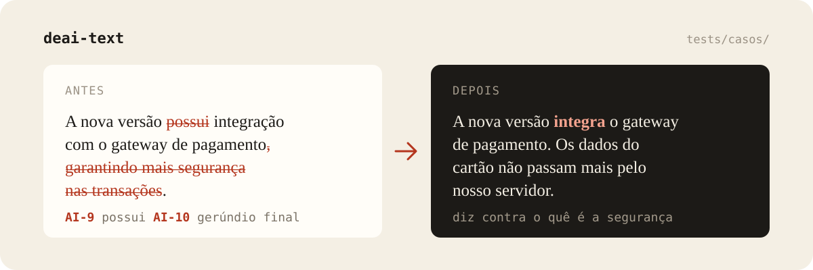
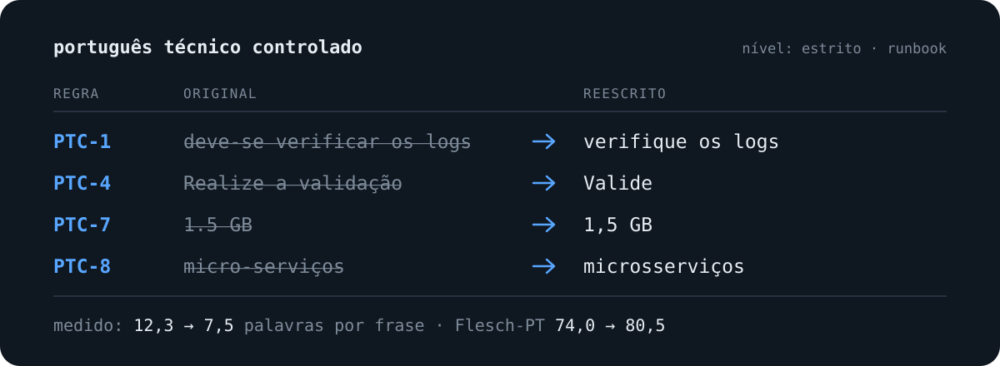

# Kayque 👋

Escrevo código desde 2002, quando tinha 11 anos, e trabalho com isso desde 2013. Sou **Gerente de Tecnologia da Informação** na ImobiBrasil desde 2018. Lá cuido do CRM imobiliário de ponta a ponta: backend em PHP e MySQL, app em Flutter e a infraestrutura.

Fora do trabalho, escrevo skills para o Claude Code que revisam texto em português e faço um jogo educativo sobre água no mestrado.

## Projetos

### ✂️ [deai-text](https://github.com/kayquer/deai-text)

Remove padrões de texto de IA. Cada trecho marcado sai com o ID da regra, a skill reescreve e depois faz uma segunda passada na reescrita.

<a href="https://github.com/kayquer/deai-text"></a>

O catálogo em português é próprio, não tradução do inglês: pega o gerúndio final, o `possui` no lugar de `tem` e decalques como `alavancar`. A suíte de regressão testa também o que **não** deve ser marcado.

```bash
claude plugin marketplace add kayquer/deai-text
claude plugin install deai-text
```

Também funciona como system prompt em qualquer outro LLM.

### 📐 [Português Técnico Controlado](https://github.com/kayquer/portugues-tecnico-controlado)

Reescreve texto técnico em PT-BR para ter uma leitura só. Inspirada no ASD-STE100, com 9 regras próprias, 3 níveis de rigor e um modo bilíngue EN/PT que confere se as duas versões dizem a mesma coisa.

<a href="https://github.com/kayquer/portugues-tecnico-controlado"></a>

Serve para tutorial, documentação, runbook e procedimento. → [Página de instalação](https://kayquer.github.io/portugues-tecnico-controlado/) (Claude Code, Claude.ai, Cursor, Codex, Gemini CLI, ChatGPT e Perplexity)

### 💧 [Guardião da Água](https://github.com/kayquer/guardiao_da_agua_js)

<a href="https://kayquer.github.io/guardiao_da_agua_js/"></a>

Jogo educativo de construção de cidade sobre recursos hídricos, para o 6º ano. O estudante governa a cidade e aprende de onde vem a água, por que ela falta ou fica poluída e como cada escolha afeta rios e nascentes. Pesquisa de mestrado na Unesp, feito em JavaScript com Babylon.js.

**[▶ Jogar no navegador](https://kayquer.github.io/guardiao_da_agua_js/)**, sem instalar nada.

### ⚔️ [Batalha Naval](https://github.com/kayquer/batalha-naval)

O jogo clássico implementado em C.

## 🛠️ Stack

PHP · MySQL · JavaScript · Flutter · C · HTML e CSS · Cloudflare · Git · Claude Code

## 📫 Contato

Para os projetos, as issues do repositório são o melhor caminho. Para o resto, e-mail ou LinkedIn. Moro em Presidente Prudente, SP.

<div align="center">
  <a href="mailto:kayquerocha@gmail.com" target="_blank">
    
  </a>
  <a href="https://www.linkedin.com/in/kayquerotondo/" target="_blank">
    
  </a>
  <a href="https://www.instagram.com/kayquerotondo/" target="_blank">
    
  </a>
</div>

---

<div align="center">
  
</div>
